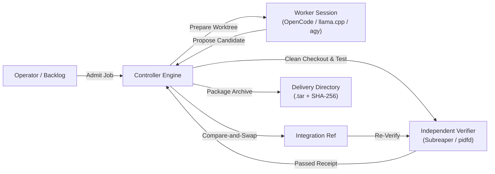

# Code Factory Controller

A durable, standalone Rust controller for autonomous code factories. It manages the full lifecycle of turning approved programming tasks into independently verified Git changes, verified integration commits, and checked local delivery artifacts.

Coding workers execute in isolated Git worktrees via [OpenCode](https://github.com/anomaly/opencode), a native local [llama.cpp](docs/native-llama-cpp.md) endpoint, or the [agy connector](docs/agy-connector.md). The controller independently verifies candidate code in fresh checkouts, coordinates compare-and-swap integration, and produces immutable delivery archives.

---

## Key Guarantees and Architecture



- **Independent Verification**: Coding workers and LLMs never self-certify. Model completion messages and terminal idle states are treated as hints, not acceptance. All verification commands run in clean checkouts under Linux process supervision (`pidfd` and subreaper).
- **Durable State Machine**: Jobs, attempts, leases, state transitions, receipts, and request identities are transactionally persisted in SQLite. The controller recovers cleanly from interruptions without duplicate execution or orphaned leases.
- **Strict Scope Boundaries**: Worker file access is bounded by explicit `allowed_paths` and `protected_paths`. Attempting to modify forbidden files or escape the worktree halts the attempt.
- **Zero Paid Fallback**: Enforces strict allowlists for free/local models, zero spend ceilings, and durable provider cooldowns. If an eligible model is unavailable, execution pauses rather than substituting a paid API.
- **Immutable Delivery**: Accepted changes produce an immutable Git archive (`.tar`) with a verified SHA-256 digest in the configured delivery directory. Optional adapters can update bound GitHub pull requests without merging or deploying.

---

## Installation and Build

### Prerequisites

- **Linux** (x86_64 or aarch64) with kernel support for `pidfd` and subreaper process trees
- **Rust 1.95+** and `cargo`
- **Git**
- **Python 3** (for the CLI wrapper, goal orchestration, and dashboard)

### Automatic CLI Installation

To install `code-factory` and `code-factory-controller` into `~/.local/bin` with optional daily update checks via systemd:

```sh
python3 scripts/code-factory.py install --auto-update
```

Ensure `~/.local/bin` is in your `PATH`. Verify the installation:

```sh
code-factory --version
```

### Manual Build

Build the controller binary directly using Cargo:

```sh
cargo build --locked --release
```

The resulting binary is located at `target/release/code-factory-controller`.

### Running Tests

Run the full Rust verification and test suite:

```sh
cargo fmt --check
cargo clippy --locked --all-targets -- -D warnings
cargo test --locked
```

---

## Quickstart

### 1. Configure the Controller

Create a project configuration file (see [examples/controller.json](examples/controller.json)). Specify your Git repository, an isolated state directory, a delivery directory, approved models, and trusted verification profiles:

```json
{
  "project_id": "my-project",
  "repository": "/absolute/path/to/my-repo",
  "data_dir": "/absolute/path/to/controller-data",
  "delivery_dir": "/absolute/path/to/deliveries",
  "integration_ref": "refs/heads/factory-integration",
  "profiles": [
    {
      "id": "standard-tests",
      "version": "1",
      "timeout_seconds": 300,
      "checks": [
        {
          "id": "unit-tests",
          "argv": ["cargo", "test", "--locked"]
        }
      ]
    }
  ],
  "policy": {
    "models": ["opencode/free-model"],
    "free_only": true,
    "spend_ceiling": 0.0,
    "data_approved": true,
    "cooldown_seconds": 30
  },
  "max_workers": 2,
  "lease_seconds": 3600,
  "max_attempts": 3
}
```

> [!IMPORTANT]
> The `data_dir` and `delivery_dir` directories must reside outside the worker repository to prevent workers from tampering with controller state or artifacts.

### 2. Start the Controller Service

Generate an operator token and launch the service:

```sh
export FACTORY_OPERATOR_TOKEN="$(openssl rand -hex 32)"
code-factory-controller serve --config /path/to/controller.json --listen 127.0.0.1:4317
```

Keep `FACTORY_OPERATOR_TOKEN` in the environment of any operator CLI or TUI session. The operator listener binds strictly to loopback (`127.0.0.1`).

---

## Interacting with the Controller

### Terminal UI (TUI)

Launch the interactive terminal interface to admit work, monitor live activity, and inspect verification logs:

```sh
code-factory tui --url http://127.0.0.1:4317
```

You can also preview the interface in demo mode without a running controller:

```sh
code-factory tui --demo
```

#### TUI Keyboard Shortcuts

| Key | Action |
| --- | --- |
| `↑` / `↓` or `k` / `j` | Navigate job list |
| `Tab` or `1` / `2` / `3` | Switch tabs: Overview, Evidence, Activity |
| `PgUp` / `PgDn` | Scroll details, reviews, or logs |
| `n` | Create a new job draft interactively |
| `i` | Import job definition from a JSON file |
| `Ctrl+S` then `y` | Review and admit job draft to queue |
| `r` then `y` | Run selected job |
| `p` | Pause or resume selected job |
| `a` / `c` / `x` | Abort worker / Cancel job / Requeue |
| `[` / `]` then `l` | Select and inspect verification log |
| `?` / `Esc` | Help / Close overlay / Back |
| `q` or `Ctrl+C` | Exit TUI (running controller jobs continue) |

### Operator CLI

The operator CLI enables scripted and headless control of the controller:

```sh
# Admit a job definition
code-factory-controller operator admit --input /path/to/job.json

# Start or reconcile execution
code-factory-controller operator run --job my-job-id

# Inspect job state and receipts
code-factory-controller operator status --job my-job-id

# Pause, resume, abort, or requeue
code-factory-controller operator pause --job my-job-id
code-factory-controller operator resume --job my-job-id
code-factory-controller operator abort --job my-job-id
code-factory-controller operator requeue --job my-job-id
```

Additional operator operations include `list`, `prepare`, `bind`, `heartbeat`, `overview`, `events`, and `log`.

---

## Worker Backends and Connectors

Code Factory supports three distinct worker execution models:

### 1. OpenCode Adapter & Plugin

Connects to an external [OpenCode](https://github.com/anomaly/opencode) instance. In adapter mode, the controller communicates directly with OpenCode's HTTP API (`opencode serve`). In plugin mode, the worker interacts using the [Protocol 0.1](docs/protocol.md) tools (`factory_status`, `factory_next_task`, `factory_request_verification`, `factory_submit_candidate`).

```sh
OPENCODE_CONFIG=/path/to/opencode.json opencode serve --hostname 127.0.0.1 --port 4096
```

See [examples/opencode.json](examples/opencode.json) and [OpenCode V2 Authority](docs/opencode-v2-authority.md) for external execution details.

### 2. Native Local llama.cpp Connector

Runs an in-process, bounded tool loop directly against a local llama.cpp OpenAI-compatible endpoint without requiring OpenCode or companion plugins. The model is given restricted file manipulation tools (`read_file`, `list_files`, `write_file`, `delete_file`, `finish_candidate`) strictly confined to the assigned worktree.

See the [Native llama.cpp Guide](docs/native-llama-cpp.md) and [examples/controller.llama-cpp.bonsai.json](examples/controller.llama-cpp.bonsai.json).

### 3. Native agy Connector

An opt-in connector providing process isolation and token accounting for pinned [agy](docs/agy-connector.md) CLI workflows. See [examples/controller.agy.json](examples/controller.agy.json).

---

## Verification and Evidence Contracts

### Exit-Status Checks

Standard checks pass if the verification command exits with return code `0`.

### Structured Result Contracts

For checks that must prove tests actually ran (preventing false passes from no-op or skipped runs), configure a `result_contract`:

```json
{
  "id": "unit-tests",
  "argv": ["python3", "scripts/run-tests.py"],
  "result_contract": {
    "evidence_type": "unit_tests"
  }
}
```

The verifier command must print a single JSON object to `stdout`:

```json
{
  "commit": "<FACTORY_VERIFICATION_COMMIT>",
  "evidence_type": "unit_tests",
  "passed": true,
  "skipped": false,
  "executed": 42,
  "failed": 0
}
```

The controller injects `FACTORY_VERIFICATION_COMMIT` into the verifier's environment. The reported commit must match exactly, `executed` must be greater than zero, and `failed` must equal zero. Missing or mismatched results fail verification regardless of exit code.

---

## Sustained Backlogs and Goal Runner

For multi-step feature sets or multi-task backlogs, `code-factory-controller run` executes a sequential manifest of approved jobs:

```sh
code-factory-controller run \
  --manifest /path/to/goal.json \
  --state /path/to/goal-state.json \
  --url http://127.0.0.1:4317 \
  --max-seconds 86400
```

- **Chained Integration**: Each completed task integrates into the integration ref and becomes the base commit for the subsequent task.
- **Rework Fencing**: If candidate verification fails, diagnostics are preserved and forwarded to the next attempt as rework context while keeping original constraints fixed.
- **Mandatory Final Acceptance**: Whole-goal completion requires all tasks to succeed followed by passing a clean-checkout acceptance test suite on the final integrated commit.

---

## Schemas and Contracts

- Core schemas are stored under `schemas/`:
  - `schemas/config.json`
  - `schemas/approved-job.json`
  - `schemas/verification-receipt.json`
  - `schemas/worker-request.json`
- Regenerate schemas from Rust definitions:
  ```sh
  cargo run --locked -- schemas --output schemas
  ```
- Client contracts for Protocol 0.1 are pinned under `contracts/plugin-0.1/`.

---

## Documentation Index

- [Architecture & State Machine](docs/architecture.md): Durable transitions, recovery boundaries, and execution models.
- [Protocol 0.1 Specification](docs/protocol.md): HTTP contract for worker capabilities and tool interactions.
- [Verifier Process Lifecycle](docs/verifier-process-lifecycle.md): Linux subreaper and `pidfd` process containment.
- [Native llama.cpp Connector](docs/native-llama-cpp.md): Direct local inference integration.
- [OpenCode V2 Authority](docs/opencode-v2-authority.md): External execution observation and recovery.
- [Trace Ledger](docs/trace-ledger.md): Provenance-preserving record and deterministic replay.
- [GitHub Review Delivery](docs/github-review-delivery.md): Private pull request updates after verified integration.
- [Verified Main Publication](docs/main-publication.md): Gated publication workflows with preflight CI checks.
- [Local Web Dashboard](dashboard/README.md): Read-only browser dashboard for inspecting state and receipts.

---

## License

This project is licensed under the [MIT License](LICENSE). Third-party notices and contract attributions are maintained in [THIRD_PARTY_NOTICES.md](THIRD_PARTY_NOTICES.md).
